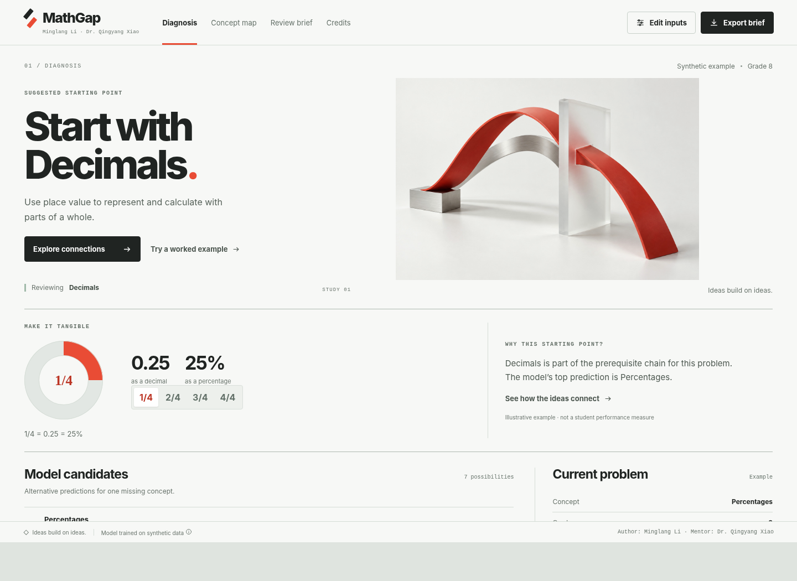

# MathGap — AI Math Concept-Gap Diagnosis Workspace

A GitHub-ready Streamlit application that uses a saved machine-learning model
to explore possible mathematics concept gaps after an incorrect answer. The
attached **MathGap Diagnosis Workspace** UI has been integrated into a single
Streamlit deployment, so the app does not require a separate React server or
FastAPI service.

> **Author:** Minglang Li  
> **Mentor:** Dr. Qingyang Xiao



## What is included

- A polished, responsive workspace adapted from the supplied UI ZIP
- **Diagnosis**, **Concept map**, **Review brief**, and **Credits** tabs
- Editable research inputs and three ready-to-run example scenarios
- Direct inference through the bundled `RandomForestClassifier`
- Seven ranked concept candidates and a recommended review concept
- Interactive mathematical figures and prerequisite relationships
- Printable review brief and downloadable JSON result
- Author and mentor credits in the browser title, app header, footer, Credits
  tab, About panel, review brief, and exported result
- Original notebook, data-generation code, sample synthetic data, model
  artifact, backend tests, and the supplied React/Vite source for reference

## Important research limitation

This is an educational **research prototype** trained and evaluated on
synthetic data. Model scores are uncalibrated probabilities for alternative
labels. They are not measured mastery, a confirmed diagnosis, a grade, or an
educational placement decision.

Use only synthetic, public, or explicitly approved non-sensitive data. Do not
enter or commit CUI, FOUO, ITAR, EAR, PII, PHI, real student records, or other
confidential information.

## Repository structure

```text
Minglang-MathGap-Diagnosis-Streamlit-App/
├── app.py                         # Streamlit entry point
├── requirements.txt              # Python dependencies
├── runtime.txt                   # Recommended local Python version marker
├── README.md
├── AUTHORS.md
├── UI_INTEGRATION.md
├── DEPLOYMENT_GUIDE.md
├── SECURITY.md
├── LICENSE
├── .gitignore
├── .streamlit/
│   └── config.toml
├── component/                     # UI served by Streamlit
│   ├── index.html
│   ├── styles.css
│   ├── app.js
│   └── art/
├── src/
│   ├── streamlit_backend.py       # Input validation and model adapter
│   ├── diagnosis_engine.py
│   └── concept_content.py
├── artifacts/
│   └── model_bundle.joblib
├── data/                          # Synthetic example data
├── notebooks/                     # Original notebook and extracted source
├── scripts/
│   └── build_artifacts.py
├── tests/
│   ├── smoke_test.py
│   ├── test_backend.py
│   └── test_component_contract.py
└── ui_source_original/            # Preserved attached React/Vite source
```

## Architecture

The original attached UI expected a React/Vite frontend and a separate FastAPI
backend. This repository adapts the interface into a static Streamlit custom
component and calls the model directly from Python:

```text
Streamlit-hosted browser component
               │
               │ validated component event
               ▼
             app.py
               │
               ▼
    src/streamlit_backend.py
               │
               ▼
 artifacts/model_bundle.joblib
```

This means **Streamlit Cloud launches only `app.py`**. Node.js, npm, React,
Vite, FastAPI, and Uvicorn are not required for the deployed app.

## Run locally on Windows 11

### 1. Extract the ZIP

Right-click the downloaded ZIP and choose **Extract All**. Open PowerShell or
Windows Terminal in the extracted repository folder.

### 2. Confirm Python

Python 3.11 is recommended because it matches the original workspace setup.

```powershell
py -3.11 --version
```

### 3. Create and activate a virtual environment

```powershell
py -3.11 -m venv .venv
Set-ExecutionPolicy -Scope Process -ExecutionPolicy Bypass
.\.venv\Scripts\Activate.ps1
```

For Command Prompt instead:

```bat
py -3.11 -m venv .venv
.venv\Scripts\activate.bat
```

For Git Bash instead:

```bash
py -3.11 -m venv .venv
source .venv/Scripts/activate
```

### 4. Install dependencies

```powershell
python -m pip install --upgrade pip
python -m pip install -r requirements.txt
```

### 5. Verify the repository

```powershell
python tests/smoke_test.py
python -m unittest discover -s tests -p "test_*.py" -v
```

### 6. Start the app

```powershell
python -m streamlit run app.py
```

Streamlit will print a local address. Open that address in your browser if it
does not open automatically.

## Run locally on macOS or Linux

```bash
python3.11 -m venv .venv
source .venv/bin/activate
python -m pip install --upgrade pip
python -m pip install -r requirements.txt
python tests/smoke_test.py
python -m unittest discover -s tests -p 'test_*.py' -v
python -m streamlit run app.py
```

## Upload to a new GitHub repository

### Option A — GitHub website

1. Sign in to GitHub and create a new repository.
2. Suggested repository name:
   `Minglang-MathGap-Diagnosis-Streamlit-App`
3. Do not initialize the new repository with another README, `.gitignore`, or
   license, because those files already exist here.
4. Extract this ZIP locally.
5. Open the extracted top-level folder.
6. Upload **all files and folders inside it**, including hidden folders such as
   `.streamlit`.
7. Commit the upload to the `main` branch.
8. Confirm that `app.py`, `requirements.txt`, `component/`, `src/`, and
   `artifacts/model_bundle.joblib` are visible at the repository root.

### Option B — Git command line

From the extracted repository root:

```bash
git init
git add .
git commit -m "Integrate MathGap UI with Streamlit model app"
git branch -M main
git remote add origin https://github.com/YOUR_USERNAME/Minglang-MathGap-Diagnosis-Streamlit-App.git
git push -u origin main
```

Replace `YOUR_USERNAME` with your GitHub username. If Git reports that the
remote already contains commits, create an empty repository or reconcile the
remote history before pushing.

## Deploy on Streamlit Community Cloud

1. Sign in to Streamlit Community Cloud using the GitHub account that owns the
   repository.
2. Choose **Create app** and select the option for an existing app/repository.
3. Enter or select:
   - **Repository:** your uploaded GitHub repository
   - **Branch:** `main`
   - **Main file path:** `app.py`
4. Open **Advanced settings** and select **Python 3.11**.
5. This app does not require secrets. Leave the secrets field empty unless you
   add your own private service later.
6. Deploy the app and monitor the build log.
7. After launch, verify all four tabs, open **Edit inputs**, run a different
   scenario, and test **Review brief** and **Download JSON**.

## Expected Streamlit settings

```text
Repository:     YOUR_USERNAME/Minglang-MathGap-Diagnosis-Streamlit-App
Branch:         main
Main file path: app.py
Python version: 3.11
Secrets:        none required
```

## Updating the app later

Edit the repository and push to `main`. For ordinary source changes, Streamlit
Community Cloud will rebuild or refresh the app from the repository. Keep the
following deployment-critical files together:

- `app.py`
- `requirements.txt`
- `.streamlit/config.toml`
- `component/`
- `src/`
- `artifacts/model_bundle.joblib`

## Rebuild the synthetic model artifact

The repository already includes the compatible artifact. To regenerate it from
the project scripts:

```bash
python scripts/build_artifacts.py
python tests/smoke_test.py
```

Commit the regenerated `artifacts/model_bundle.joblib` only after the smoke
test passes. Model artifacts can become incompatible across scikit-learn
versions, so this repository pins `scikit-learn==1.8.0`.

## UI source and future development

The deployed interface lives in `component/` and has no Node dependency. The
original attached React/Vite source is preserved in `ui_source_original/` for
future design work. It is intentionally not part of the Streamlit runtime.
Read `UI_INTEGRATION.md` before replacing the component or reconnecting the
original two-service architecture.

## Troubleshooting

### `ModuleNotFoundError`

Confirm the virtual environment is active and reinstall dependencies:

```bash
python -m pip install -r requirements.txt
```

### Streamlit says the model cannot be loaded

Confirm this file exists in GitHub:

```text
artifacts/model_bundle.joblib
```

Also confirm the deployment installed `scikit-learn==1.8.0`.

### The page loads but the custom UI is missing

Confirm that the complete `component/` directory was uploaded, especially:

```text
component/index.html
component/app.js
component/styles.css
component/art/connection-study.jpg
component/art/loop-study.jpg
```

### The app is cropped or shows excessive blank space

Reload the browser once after deployment. The custom component reports its
height to Streamlit after each navigation/render. Also confirm that no browser
extension is blocking iframe scripts.

### GitHub did not upload `.streamlit`

Folders beginning with a period may be hidden by some file browsers. Confirm
`.streamlit/config.toml` appears in GitHub. Git command-line upload includes it
automatically unless your global Git configuration excludes it.

### Dependency installation takes too long

Review the Streamlit build log. Do not remove `requirements.txt` or the pinned
scikit-learn version. The app requires the saved estimator, NumPy, pandas, and
joblib.

## License

See [LICENSE](LICENSE).
